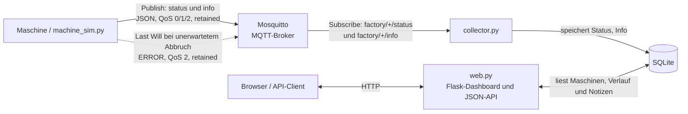

# Machine Monitor – Projektdokumentation

## Architektur und Kommunikationswege



- **Maschine oder Simulator:** veröffentlicht Status- und Info-Nachrichten.
- **Mosquitto:** nimmt MQTT-Nachrichten entgegen, verteilt sie an Abonnenten
  und hält retained Nachrichten vor. Bei unerwartetem Client-Abbruch sendet
  der Broker das vorher registrierte Last Will.
- **Collector:** abonniert die Maschinen-Topics und speichert Nachrichten in
  SQLite.
- **SQLite:** speichert Maschineninformationen, den Statusverlauf und
  Logbuchnotizen.
- **Flask-Web-App:** liest und bearbeitet Datenbankinhalte; Browser und
  API-Clients kommunizieren mit ihr über HTTP.

Die Komponenten können auf einem Gerät oder auf mehrere Geräte verteilt
laufen. Bei einem separaten Maschinen-Pi muss `MQTT_HOST` auf die IP-Adresse
des Broker-Pis zeigen; `localhost` bezeichnet stets das Gerät, auf dem der
Prozess läuft.

## Topic-Konzept und Namenskonvention

Alle Topics folgen dieser Hierarchie:

```text
<prefix>/<machine_id>/<message_type>
```

- `prefix`: gemeinsamer Namensraum, standardmäßig `factory`; konfigurierbar
  über `MQTT_TOPIC_PREFIX`.
- `machine_id`: eindeutige und stabile Maschinenkennung, zum Beispiel
  `press-01`.
- `message_type`: Nachrichtentyp (`status` oder `info`).

Beispiele:

```text
factory/press-01/status
factory/press-01/info
factory/cnc-02/status
factory/cnc-02/info
```

Der Collector verwendet diese Abonnements:

```text
factory/+/status
factory/+/info
```

Das Wildcard-Zeichen `+` steht für genau eine Topic-Ebene, hier die
Maschinenkennung. Zum Beobachten aller Topics eines Prefix kann ein Client
`factory/#` abonnieren. Das Wildcard-Zeichen `#` umfasst beliebig viele
weitere Topic-Ebenen.

| Topic-Muster | Zweck | Retained |
|---|---|---|
| `<prefix>/<machine_id>/status` | Aktueller Zustand, Detail und Statusereignisse | Ja |
| `<prefix>/<machine_id>/info` | Maschinenbeschreibung, z. B. Name, Modell, Standort und Handbuch-URL | Ja |

Gültige Statuswerte: `RUNNING`, `IDLE`, `MAINTENANCE`, `ERROR` und `OFFLINE`.

## QoS (Quality of Service)

Die QoS-Stufe legt die MQTT-Zustellgarantie für die jeweilige Nachricht fest.
Publisher und Subscriber handeln sie pro Nachricht aus; die effektive QoS
kann nicht höher sein als die QoS der Publikation und des Abonnements.

| QoS | Verwendung im Projekt | Begründung |
|---:|---|---|
| **0 – höchstens einmal** | Regelmäßige Status-Telemetrie: `RUNNING`, `IDLE`, `MAINTENANCE` | Ein einzelner Zwischenstand darf verloren gehen, weil regelmäßig ein neuer Status folgt. Es entsteht kein MQTT-Bestätigungsverkehr. |
| **1 – mindestens einmal** | Maschineninformationen und sauber gesendetes `OFFLINE` | Die Zustellung wird bestätigt und bei Bedarf wiederholt. Doppelte Zustellung ist für diese Nachrichten unkritisch. |
| **2 – genau einmal** | Kritische `ERROR`-Statusmeldungen und Last Will | MQTT sorgt auf Protokollebene für genau einmalige Zustellung. Das benötigt mehr Protokollverkehr und garantiert nicht, dass Anwendungslogik eine Nebenwirkung genau einmal ausführt. |

Der Simulator wählt die QoS für Statusmeldungen anhand des Statuswerts. Der
Collector fordert Status mit QoS 2 und Maschineninformationen mit QoS 1 an.
Eine mit QoS 0 veröffentlichte Meldung wird dadurch nicht auf QoS 2 angehoben.

## Retained Messages

Der Simulator veröffentlicht Status und Maschineninformationen mit dem
Retain-Flag. Mosquitto speichert für jedes Topic die letzte retained Nachricht
und liefert sie einem neuen Subscriber direkt beim Abonnieren. Ein Anwendungsfall
ist der letzte bekannte Maschinenstatus: Nach einem Neustart kann der Collector
den zuletzt gespeicherten Wert erhalten, ohne auf die nächste Statusmeldung
warten zu müssen.

Retained Messages ersetzen keinen Verlauf. Der Collector speichert empfangene
Statusänderungen zusätzlich in der SQLite-Tabelle `status_log`.

## Last Will and Testament

Der Simulator registriert beim MQTT-Verbindungsaufbau für
`<prefix>/<machine_id>/status` ein retained Last Will mit QoS 2. Bricht seine
Verbindung unerwartet ab (z. B. Prozessabsturz, Stromausfall oder
Netzwerkunterbrechung), veröffentlicht Mosquitto dieses Will:

```json
{
  "state": "ERROR",
  "detail": "connection lost",
  "ts": 1700000000,
  "will": true
}
```

`ts` ist dabei der Zeitstempel, zu dem der Simulator das Will beim Broker
registriert hat. Bei einem sauberen Beenden, etwa mit Ctrl+C, sendet der
Simulator selbst den Status `OFFLINE` mit `will: false` und trennt danach die
Verbindung regulär. Dann sendet der Broker das Will nicht.

## Strukturierte JSON-Payloads und Zeitstempel

MQTT-Nachrichten werden als UTF-8-kodierte JSON-Objekte übertragen. Der
gemeinsame Payload-Vertrag sieht einen Zeitstempel `ts` als Unix-Zeit in
Sekunden vor. Statusereignisse verwenden zusätzlich `state`, `detail` und
`will`:

```json
{
  "ts": 1700000000,
  "state": "RUNNING",
  "detail": null,
  "will": false
}
```

Maschineninformationen enthalten die beschreibenden Felder:

```json
{
  "ts": 1700000000,
  "name": "Presse 1",
  "model": "SIM-1000",
  "location": "Halle A",
  "manual_url": "https://example.com/manuals/sim-1000.pdf"
}
```

**Implementierungsstand:** Der Simulator versieht Statusnachrichten und das
Last Will mit `ts`. Die derzeitige `info`-Nachricht enthält die
Beschreibungsfelder, aber noch keinen Zeitstempel. Damit das Zeitstempel-Feld
für alle Payload-Typen verpflichtend erfüllt ist, muss `ts` auch beim Erzeugen
der `info`-Nachricht ergänzt werden.

## Datenspeicherung und Weboberfläche

Die SQLite-Datenbank enthält:

- `machines`: letzte bekannte Maschineninformationen und aktueller Status.
- `status_log`: Statusverlauf mit Detail, Payload und Last-Will-Kennzeichen.
- `notes`: manuelle Logbuchnotizen.

Das Dashboard stellt eine Maschinenübersicht und Detailseiten bereit. Die
JSON-API umfasst:

```text
GET /api/machines
GET /api/machines/<machine_id>/history?limit=50
```

## Konfiguration

Die Anwendungen lesen Konfiguration aus Umgebungsvariablen, typischerweise
aus `machine-monitor.env`:

| Variable | Zweck | Standardwert |
|---|---|---|
| `MQTT_HOST` | Hostname oder IP des Brokers | `localhost` |
| `MQTT_PORT` | MQTT-Port | `1883` |
| `MQTT_USERNAME` | MQTT-Benutzername | Nicht gesetzt |
| `MQTT_PASSWORD` | MQTT-Passwort | Nicht gesetzt |
| `MQTT_TOPIC_PREFIX` | Topic-Namensraum | `factory` |
| `DB_PATH` | SQLite-Dateipfad | `machines.db` |
| `WEB_HOST` | Bind-Adresse des Webservers | `0.0.0.0` |
| `WEB_PORT` | HTTP-Port des Dashboards | `8080` |
| `LOG_LEVEL` | Python-Logging-Level | `INFO` |
